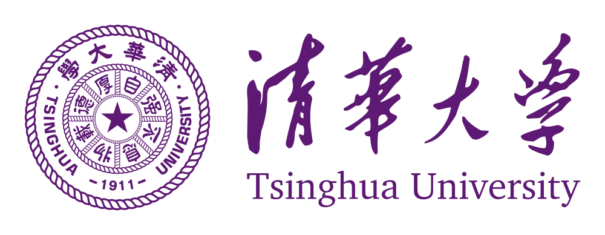

<h1 align="center">Weijue Bu</h1>

  <b>Vision-language-action models for long-horizon manipulation</b> 
  Embodied AI Algorithm Intern @ <a href="https://www.noematrix.ai/">Noematrix</a> · Incoming graduate student @ <a href="https://teai.fudan.edu.cn/">Fudan TEAI</a>

  <a href="https://muqy1818.github.io/">Homepage</a> ·
  <a href="https://scholar.google.com/citations?user=GHxEFRYAAAAJ">Google Scholar</a> ·
  <a href="mailto:weijue1215@163.com">Email</a> ·
  <a href="https://muqy1818.github.io/blog.html">Blog</a>

---

I work on **VLA policies that are fast enough for closed-loop control and still keep track of what they have done over a long task**.

- **Now** · post-training VLA models at **[Noematrix](https://www.noematrix.ai/)**, Shanghai
- **Next** · graduate study at the **[Institute of Trustworthy Embodied AI (TEAI)](https://teai.fudan.edu.cn/)**, Fudan University
- **Before** · research intern at **[Tsinghua SIGS](https://www.sigs.tsinghua.edu.cn/)**, co-first author of ChainVLA and RoboStream (ECCV 2026)
- **Long term** · **RSI (recursive self-improvement) in Embodied AI**, policies that keep improving from their own experience

## Research

| | Theme | Work |
|:-:|---|---|
| 01 | **Execution state across action chunks** Keeping a fast, chunked VLA policy aware of task progress and of the motion it was in the middle of. | [ChainVLA](https://muqy1818.github.io/chainvla-web/) |
| 02 | **Memory for long-horizon manipulation** How does a robot on step twelve still know what steps one to eleven achieved, and what is left? | [RoboStream](https://robostream123.github.io/) |
| 03 | **VLA post-training** · *now* Post-training VLA policies, a step toward robots that improve from their own rollouts. | Noematrix |
| 04 | **Diagnosing mind and action** When a policy fails, did it misunderstand the task, or fail to execute it? | [Mind2Act World](https://mind2act-world.com/) |

## Selected publications

**ChainVLA: Chaining Vision-Language-Action Queries through a Unified Execution State for Long-Horizon Manipulation** 
**Weijue Bu**\*, et al. · *Under review* · [Project Page](https://muqy1818.github.io/chainvla-web/)

**RoboStream: Weaving Spatio-Temporal Reasoning with Memory in Vision-Language Models for Robotics** 
Yuzhi Huang\*, Jie Wu\*, **Weijue Bu**\*, et al. · *ECCV 2026* · [Project Page](https://robostream123.github.io/) · [Code](https://github.com/yu2hi13/RoboStream) · [arXiv](https://arxiv.org/abs/2603.12939)

**Mind2Act World: A Diagnostic Benchmark for Embodied Mind, Physical Action, and Mind-Action Composition in Robotic Manipulation** 
Yuzhi Huang, Jie Wu, Fanding Huang, …, **Weijue Bu**, …, Jingyan Jiang, Zhi Wang · *arXiv 2026* · [Project Page](https://mind2act-world.com/) · [Code](https://github.com/Mind2Act/Mind2Act_World) · [arXiv](https://arxiv.org/abs/2611.26444)

Also: [Conscious Gaze](https://arxiv.org/abs/2512.05546) (ICME 2026, first author) · [CALO](https://github.com/MuQY1818/calo-experiments) (IEEE TCC 2026) · PiN-Mod (under review) · \* equal contribution

## Open source

<table>
  <tr>
    <td width="50%" valign="top">
       
      <b><a href="https://github.com/MuQY1818/macbot">macbot</a></b> 
      LeRobot on a MacBook: teleoperate, record, export and run ACT, π0.5 and SmolVLA, with fast inference on Apple silicon (π0.5 at ~165 ms per action chunk with MLX). 
      Python · LeRobot · MLX · Apache-2.0 · <a href="https://pypi.org/project/macbot/">PyPI</a>
    </td>
    <td width="50%" valign="top">
       
      <b><a href="https://github.com/MuQY1818/OpenYoink">OpenYoink</a></b> 
      A free macOS drag-and-drop shelf and Dynamic Island for files, images, text and links, with Quick Look previews and multi-display support. 
      SwiftUI · AppKit · MIT · <a href="https://github.com/MuQY1818/OpenYoink/releases/latest">Download</a>
    </td>
  </tr>
</table>

## Experience

<table>
  <tr>
    <td align="center" width="170"><a href="https://www.noematrix.ai/"><picture><source media="(prefers-color-scheme: dark)" srcset="assets/noematrix-logo-dark.png"></picture></a></td>
    <td><b>Embodied AI Algorithm Intern</b>, Noematrix VLA post-training</td>
    <td>2026.10 – now</td>
  </tr>
  <tr>
    <td align="center" width="170"><a href="https://www.sigs.tsinghua.edu.cn/"><picture><source media="(prefers-color-scheme: dark)" srcset="assets/tsinghua-logo-dark.svg"></picture></a></td>
    <td><b>Research Intern</b>, Tsinghua SIGS ChainVLA, RoboStream; RLBench / SIMPLER evaluation pipeline</td>
    <td>2025.12 – 2026.08</td>
  </tr>
  <tr>
    <td align="center" width="170"></td>
    <td><b>Incoming graduate student</b>, Fudan TEAI</td>
    <td>2027 –</td>
  </tr>
  <tr>
    <td align="center" width="170"></td>
    <td><b>B.Eng. in Computer Science</b>, China University of Mining and Technology</td>
    <td>2023 – 2027</td>
  </tr>
</table>

## News

- **2026.11** · Mind2Act World is on [arXiv](https://arxiv.org/abs/2611.26444), with benchmark code on [GitHub](https://github.com/Mind2Act/Mind2Act_World)
- **2026.11** · Released [macbot](https://github.com/MuQY1818/macbot), LeRobot and VLA inference on a MacBook
- **2026.10** · Joined Noematrix as an Embodied AI Algorithm Intern
- **2026.10** · Awarded the National Scholarship
- **2026.07** · RoboStream accepted to ECCV 2026

## Honors

National Scholarship (2026) · National First Prize, "Challenge Cup" (2025) · Academic Potential 1st Prize, SJTU Summer School (2025) · Bronze Medal, ICPC China Invitational (2025)

More contests

- Second Prize, 15th "China Software Cup", National Finals, 2026
- 15th Place, Tianchi Alibaba Mobile Recommendation Algorithm Challenge, 2025
- Second Prize, RAICOM Jiangsu Division Programming Skills Competition, 2025
- Second Prize (Provincial), Lanqiao Cup C/C++ Programming, 2025
- Second Prize (Provincial), Jiangsu Higher Mathematics Competition, 2024
- Third Prize (National), GPLT Group Programming Ladder Tournament, 2024

PyTorch · LeRobot · JAX · MLX · MuJoCo · RLBench · LIBERO · SIMPLER · ROS · Docker
