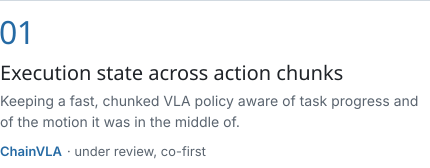
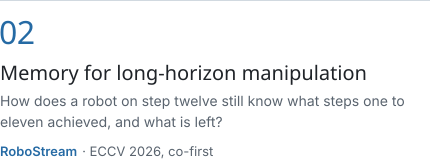
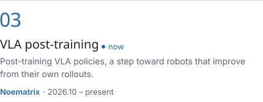
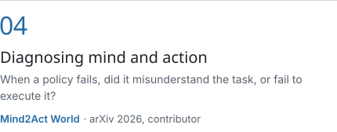
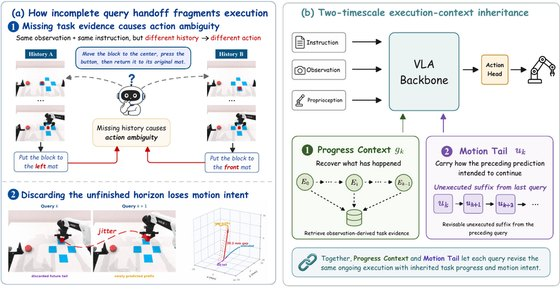
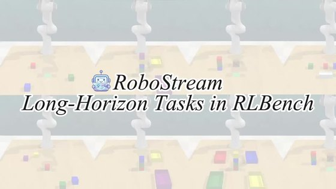
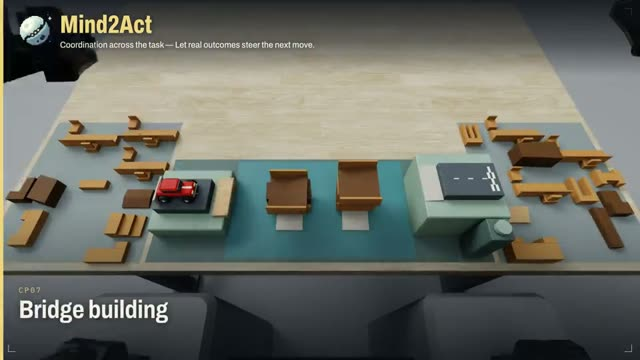

<a href="https://muqy1818.github.io/"><picture><source media="(prefers-color-scheme: dark)" srcset="assets/svg/header-dark.svg"></picture></a>

[Homepage](https://muqy1818.github.io/) &nbsp;/&nbsp; [Google Scholar](https://scholar.google.com/citations?user=GHxEFRYAAAAJ) &nbsp;/&nbsp; [Email](mailto:weijue1215@163.com) &nbsp;/&nbsp; [Blog](https://muqy1818.github.io/blog.html)

I build VLA policies that stay fast enough for closed-loop control but still remember what they have done over a long task. Right now that means post-training VLA models at [Noematrix](https://www.noematrix.ai/); next year I start graduate study at [Fudan TEAI](https://teai.fudan.edu.cn/). Before this I was at [Tsinghua SIGS](https://www.sigs.tsinghua.edu.cn/), where I was co-first author of ChainVLA and RoboStream. The longer-term question I care about is **recursive self-improvement in embodied AI**: robots that get better from their own experience.

## Research

  <a href="https://muqy1818.github.io/chainvla-web/"><picture><source media="(prefers-color-scheme: dark)" srcset="assets/svg/research-01-dark.svg"></picture></a>&nbsp;&nbsp;&nbsp;
  <a href="https://robostream123.github.io/"><picture><source media="(prefers-color-scheme: dark)" srcset="assets/svg/research-02-dark.svg"></picture></a>

  <a href="https://www.noematrix.ai/"><picture><source media="(prefers-color-scheme: dark)" srcset="assets/svg/research-03-dark.svg"></picture></a>&nbsp;&nbsp;&nbsp;
  <a href="https://mind2act-world.com/"><picture><source media="(prefers-color-scheme: dark)" srcset="assets/svg/research-04-dark.svg"></picture></a>

## Selected publications

<table>
  <tr>
    <td width="220" valign="top"></td>
    <td valign="top">
      <b><a href="https://muqy1818.github.io/chainvla-web/">ChainVLA: Chaining Vision-Language-Action Queries through a Unified Execution State for Long-Horizon Manipulation</a></b> 
      <b>Weijue Bu</b>*, et al. 
      <i>Under review</i> · <a href="https://muqy1818.github.io/chainvla-web/">Project Page</a>
    </td>
  </tr>
  <tr>
    <td width="220" valign="top"></td>
    <td valign="top">
      <b><a href="https://robostream123.github.io/">RoboStream: Weaving Spatio-Temporal Reasoning with Memory in Vision-Language Models for Robotics</a></b> 
      Yuzhi Huang*, Jie Wu*, <b>Weijue Bu</b>*, et al. 
      <i>ECCV 2026</i> · <a href="https://robostream123.github.io/">Project Page</a> · <a href="https://github.com/yu2hi13/RoboStream">Code</a> · <a href="https://arxiv.org/abs/2603.12939">arXiv</a>
    </td>
  </tr>
  <tr>
    <td width="220" valign="top"></td>
    <td valign="top">
      <b><a href="https://mind2act-world.com/">Mind2Act World: A Diagnostic Benchmark for Embodied Mind, Physical Action, and Mind-Action Composition in Robotic Manipulation</a></b> 
      Yuzhi Huang, Jie Wu, Fanding Huang, …, <b>Weijue Bu</b>, …, Jingyan Jiang, Zhi Wang 
      <i>arXiv 2026</i> · <a href="https://mind2act-world.com/">Project Page</a> · <a href="https://github.com/Mind2Act/Mind2Act_World">Code</a> · <a href="https://arxiv.org/abs/2611.26444">arXiv</a>
    </td>
  </tr>
</table>

Also: [Conscious Gaze](https://arxiv.org/abs/2512.05546) (ICME 2026, first author) · [CALO](https://github.com/MuQY1818/calo-experiments) (IEEE TCC 2026) · PiN-Mod (under review) · \* equal contribution

## Open source

<table>
  <tr>
    <td width="50%" valign="top">
       
      <b><a href="https://github.com/MuQY1818/macbot">macbot</a></b> 
      LeRobot on a MacBook: teleoperate, record, export and run ACT, π0.5 and SmolVLA, with fast inference on Apple silicon (π0.5 at ~165 ms per action chunk with MLX). 
      Python · LeRobot · MLX · Apache-2.0 · <a href="https://pypi.org/project/macbot/">PyPI</a>
    </td>
    <td width="50%" valign="top">
       
      <b><a href="https://github.com/MuQY1818/OpenYoink">OpenYoink</a></b> 
      A free macOS drag-and-drop shelf and Dynamic Island for files, images, text and links, with Quick Look previews and multi-display support. 
      SwiftUI · AppKit · MIT · <a href="https://github.com/MuQY1818/OpenYoink/releases/latest">Download</a>
    </td>
  </tr>
</table>

## Experience

<table>
  <tr>
    <td align="center" width="170"><a href="https://www.noematrix.ai/"><picture><source media="(prefers-color-scheme: dark)" srcset="assets/noematrix-logo-dark.png"></picture></a></td>
    <td><b>Embodied AI Algorithm Intern</b>, Noematrix VLA post-training</td>
    <td>2026.10 – now</td>
  </tr>
  <tr>
    <td align="center" width="170"><a href="https://www.sigs.tsinghua.edu.cn/"><picture><source media="(prefers-color-scheme: dark)" srcset="assets/tsinghua-logo-dark.svg"></picture></a></td>
    <td><b>Research Intern</b>, Tsinghua SIGS ChainVLA, RoboStream; RLBench / SIMPLER evaluation pipeline</td>
    <td>2025.12 – 2026.08</td>
  </tr>
  <tr>
    <td align="center" width="170"></td>
    <td><b>Incoming graduate student</b>, Fudan TEAI</td>
    <td>2027 –</td>
  </tr>
  <tr>
    <td align="center" width="170"></td>
    <td><b>B.Eng. in Computer Science</b>, China University of Mining and Technology</td>
    <td>2023 – 2027</td>
  </tr>
</table>

## News

- **2026.11** · Mind2Act World is on [arXiv](https://arxiv.org/abs/2611.26444), with benchmark code on [GitHub](https://github.com/Mind2Act/Mind2Act_World)
- **2026.11** · Released [macbot](https://github.com/MuQY1818/macbot), LeRobot and VLA inference on a MacBook
- **2026.10** · Joined Noematrix as an Embodied AI Algorithm Intern
- **2026.10** · Awarded the National Scholarship
- **2026.07** · RoboStream accepted to ECCV 2026

## Honors

National Scholarship (2026) · National First Prize, "Challenge Cup" (2025) · Academic Potential 1st Prize, SJTU Summer School (2025) · Bronze Medal, ICPC China Invitational (2025)

More contests

- Second Prize, 15th "China Software Cup", National Finals, 2026
- 15th Place, Tianchi Alibaba Mobile Recommendation Algorithm Challenge, 2025
- Second Prize, RAICOM Jiangsu Division Programming Skills Competition, 2025
- Second Prize (Provincial), Lanqiao Cup C/C++ Programming, 2025
- Second Prize (Provincial), Jiangsu Higher Mathematics Competition, 2024
- Third Prize (National), GPLT Group Programming Ladder Tournament, 2024

Tools I use most: PyTorch · LeRobot · JAX · MLX · MuJoCo · RLBench · LIBERO · SIMPLER · ROS · Docker

<picture><source media="(prefers-color-scheme: dark)" srcset="assets/svg/signature-dark.svg"></picture>

